# Axcenity Wardrobe 0.1.0: the garments

Written by `tools/build_pack.py`. Each garment alone, from the front (`tools/render_previews.py`).

## Bottom

| | Garment | ID | Triangles | Size |
|---|---|---|---|---|
| 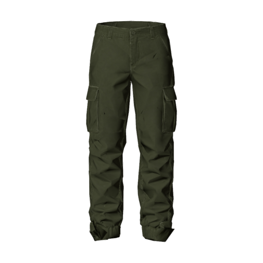 | Cargo pants | `generated/cargo-pants` | 7,531 | 19 MB |
| 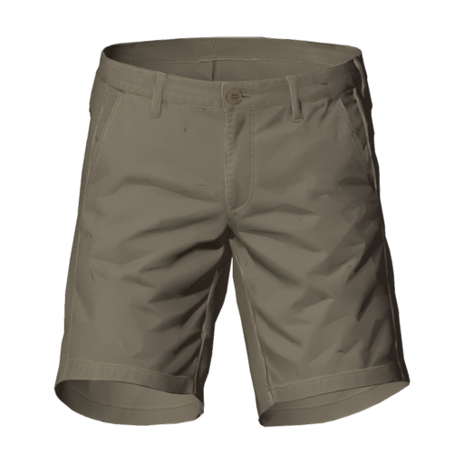 | Chino shorts | `generated/chino-shorts` | 5,999 | 14 MB |
| 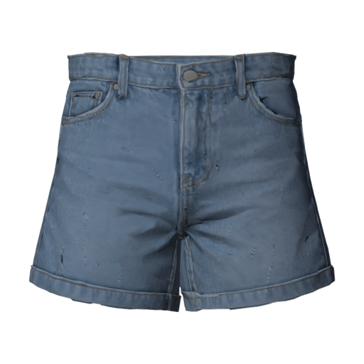 | Denim shorts | `generated/denim-shorts` | 5,999 | 16 MB |
| 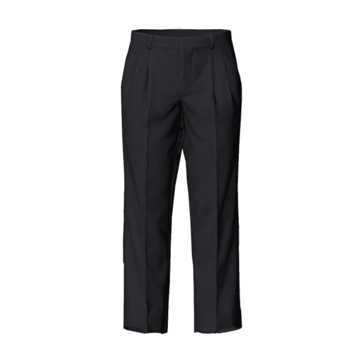 | Dress trousers | `generated/dress-trousers` | 5,999 | 15 MB |
| 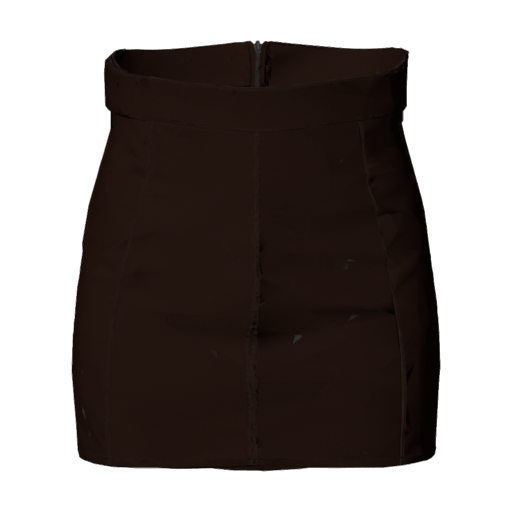 | Leather mini skirt | `generated/leather-mini-skirt` | 9,503 | 27 MB |
| 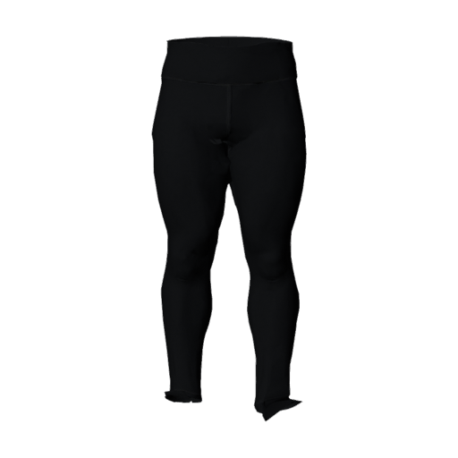 | Athletic leggings | `generated/leggings` | 6,000 | 11 MB |
| 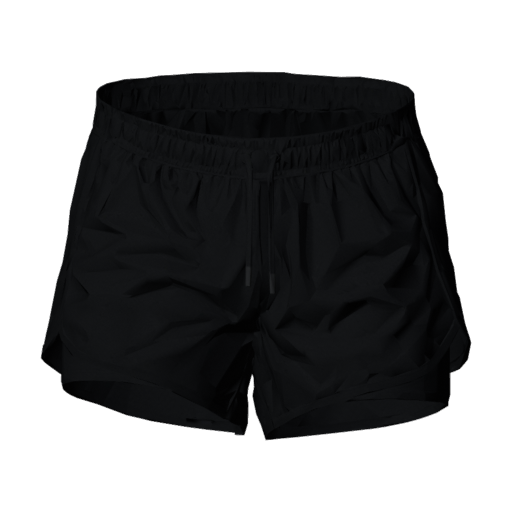 | Running shorts | `generated/running-shorts` | 8,861 | 27 MB |
| 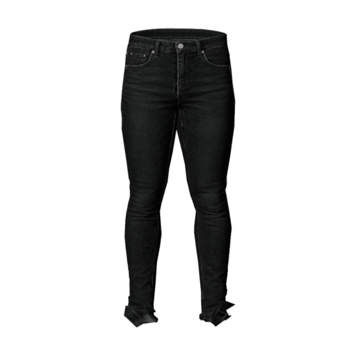 | Skinny jeans | `generated/skinny-jeans` | 6,000 | 14 MB |
| 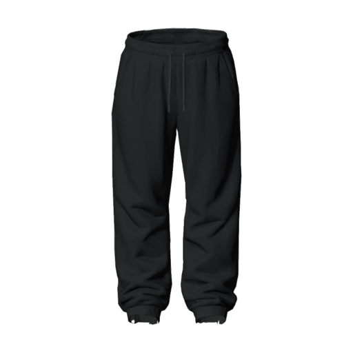 | Sweatpants | `generated/sweatpants` | 6,000 | 14 MB |
| 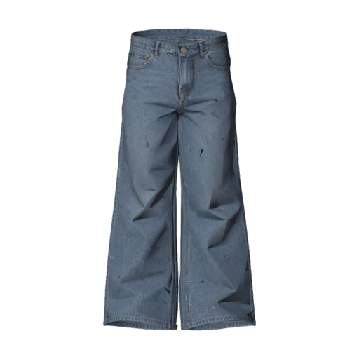 | Wide-leg jeans | `generated/wide-leg-jeans` | 5,999 | 18 MB |

## Outerwear

| | Garment | ID | Triangles | Size |
|---|---|---|---|---|
| 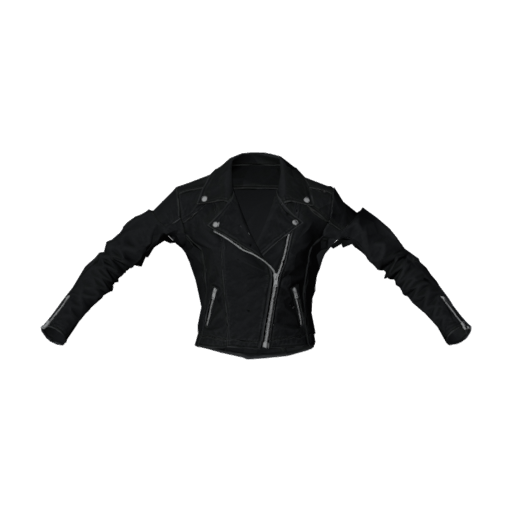 | Biker jacket | `generated/biker-jacket` | 9,999 | 28 MB |
| 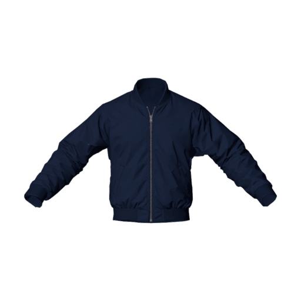 | Bomber jacket | `generated/bomber-jacket` | 10,000 | 27 MB |
| 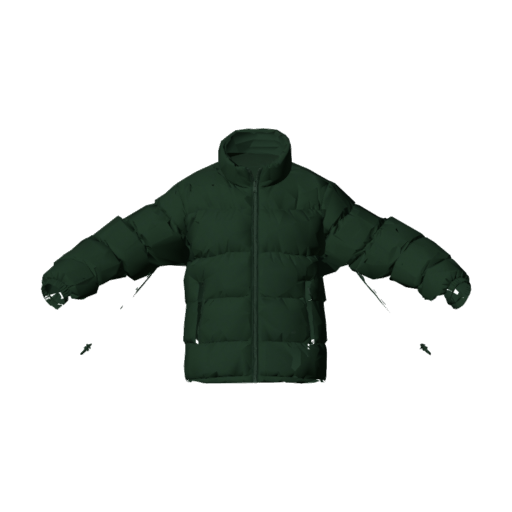 | Puffer jacket | `generated/puffer-jacket` | 12,851 | 45 MB |
| 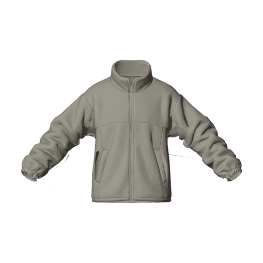 | Sherpa jacket | `generated/sherpa-jacket` | 9,999 | 22 MB |
| 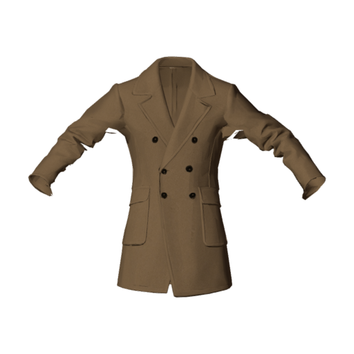 | Wool coat | `generated/wool-coat` | 9,999 | 22 MB |

## Top

| | Garment | ID | Triangles | Size |
|---|---|---|---|---|
| 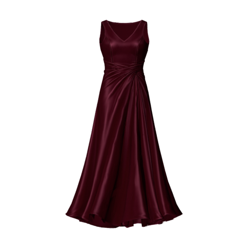 | Evening dress | `generated/burgundy-dress` | 10,000 | 17 MB |
| 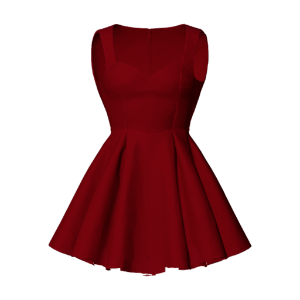 | Cocktail dress | `generated/cocktail-dress` | 10,000 | 18 MB |
| 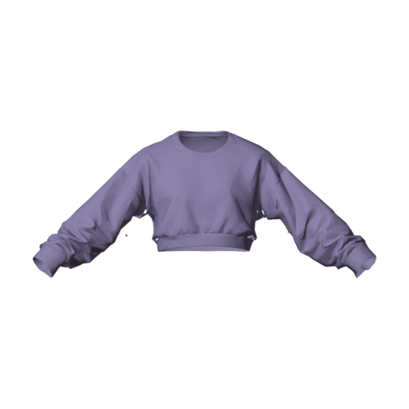 | Cropped sweatshirt | `generated/cropped-sweatshirt` | 6,000 | 14 MB |
| 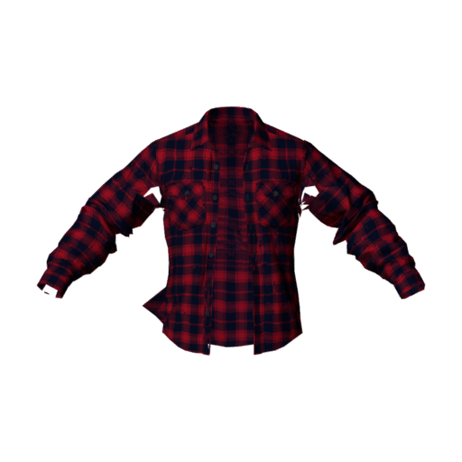 | Flannel shirt | `generated/flannel-shirt` | 5,999 | 20 MB |
| 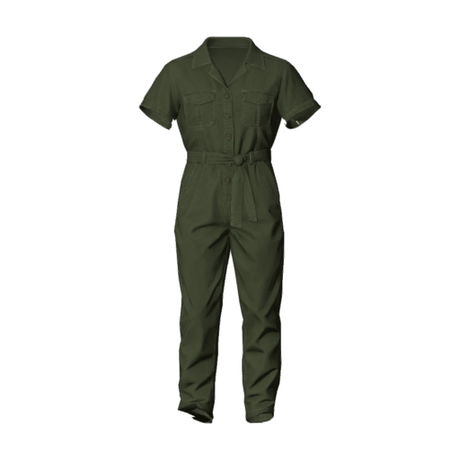 | Jumpsuit | `generated/jumpsuit` | 9,999 | 23 MB |
| 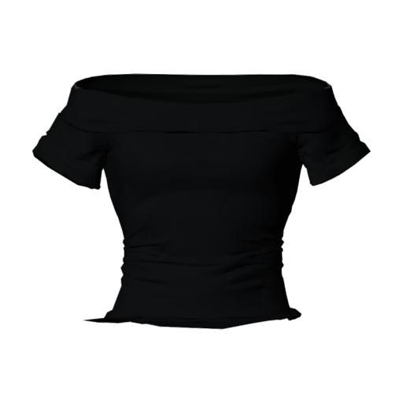 | Off-shoulder top | `generated/off-shoulder-top` | 6,000 | 15 MB |
| 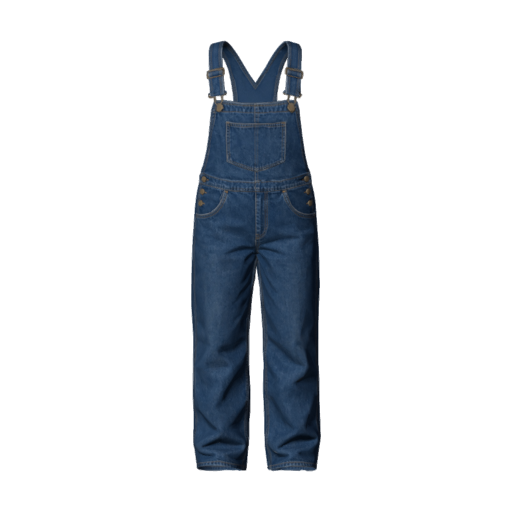 | Denim overalls | `generated/overalls` | 10,000 | 23 MB |
| 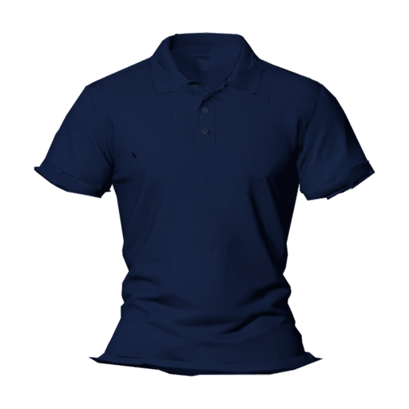 | Polo shirt | `generated/polo` | 5,999 | 16 MB |
| 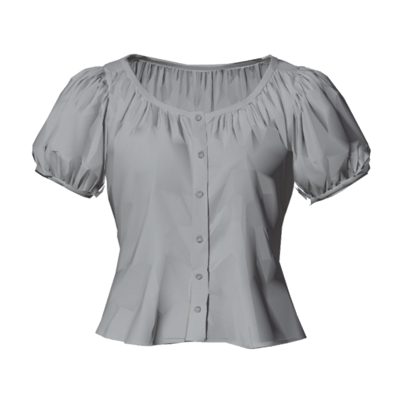 | Puff-sleeve blouse | `generated/puff-blouse` | 9,180 | 27 MB |
| 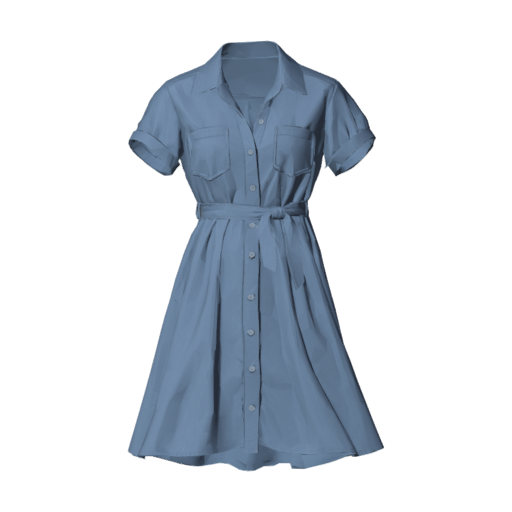 | Shirt dress | `generated/shirt-dress` | 10,000 | 28 MB |
| 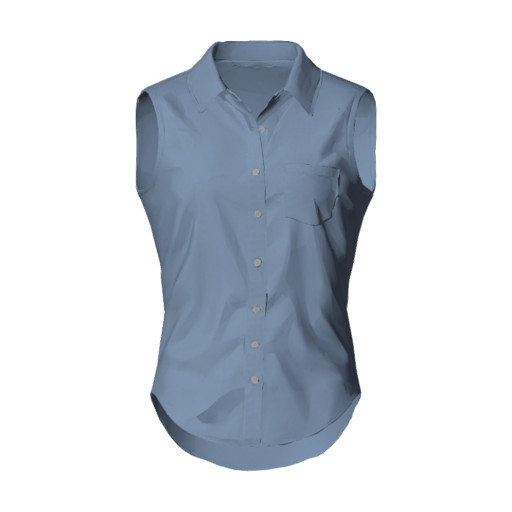 | Sleeveless blouse | `generated/sleeveless-blouse` | 5,999 | 14 MB |
| 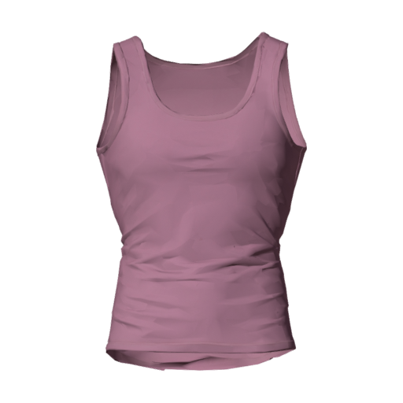 | Tank top | `generated/tank-top` | 5,999 | 13 MB |
| 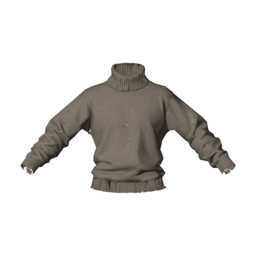 | Turtleneck sweater | `generated/turtleneck` | 8,585 | 29 MB |
| 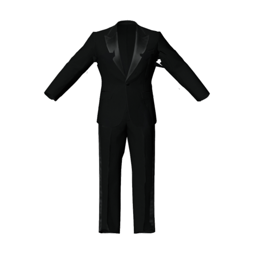 | Formal tuxedo | `generated/tuxedo` | 9,999 | 26 MB |
| 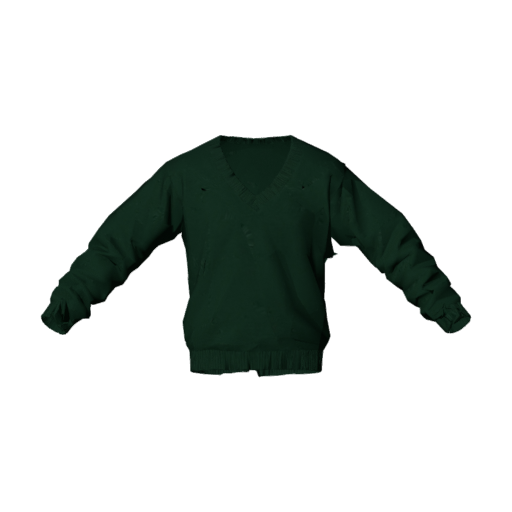 | V-neck sweater | `generated/vneck-sweater` | 6,768 | 23 MB |
