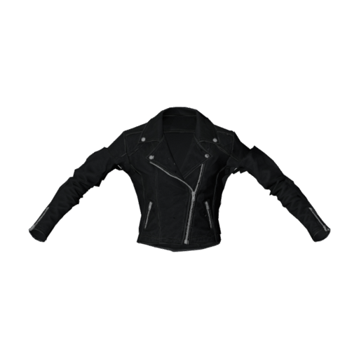
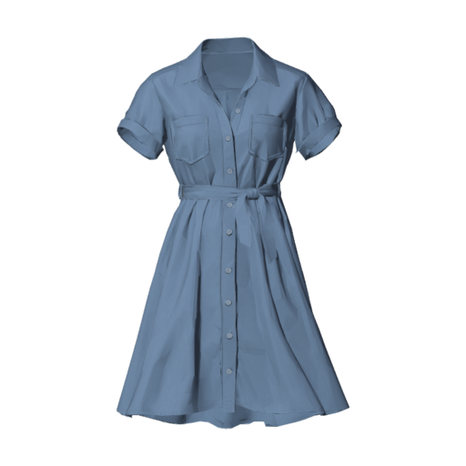
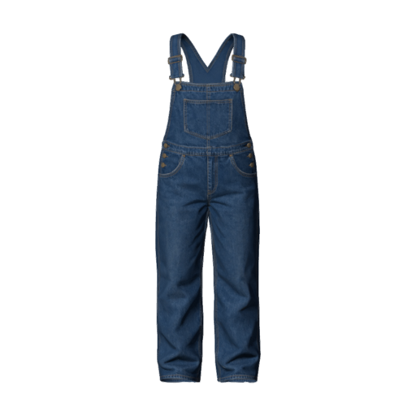
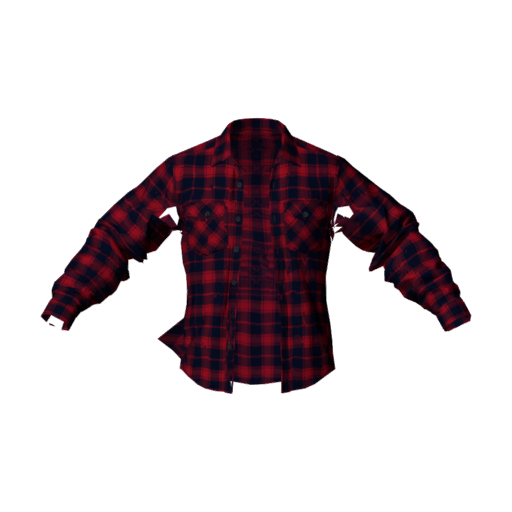
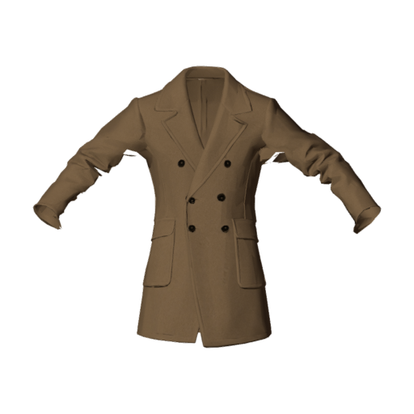

# Axcenity Wardrobe

Clothing for the realistic character of the [Axcenity Engine](https://github.com/Axcenity-Studios/Axcenity-Engine): 30 garments, each fitted to the body so it follows every body shape and the skeleton, with its colour, normal and roughness maps.

**Every garment here is a draft.** They are usable and they have faults; see [Known faults](#known-faults).

Pictures of all of them are in [GALLERY.md](GALLERY.md).

| | | | | |
|---|---|---|---|---|
|  |  |  |  |  |

## What is in it

| Path | What it is |
|---|---|
| `pack.json` | The index: every garment with its ID, label, slot, layer, triangle count, preview, and each file's size and SHA-256. Read this to list or download the pack: a file's address is `files_at` followed by its `path` |
| `library/` | The garments, at the paths they take in a character library (`realistic/imports/<name>/`): the model (`.glb`), its manifest (`.item.json`), its fit data (`.binding.json`) and its thumbnail |
| `previews/` | One 512-pixel picture of each garment |
| `outfits/` | 21 characters (`*.character.json`) that wear them, to try the garments with |
| `install.py` | Puts the garments into a character library, downloading them when it is run on its own |
| `tools/` | What builds this pack from a library the garments were imported into |

The garments are 627 MB together, between 11 and 45 MB each. Most of that is the 138 body shapes every garment carries.

## Install

The garments are not part of the engine: they are downloaded from this repository into a project. You need a project made with the engine (its character library is `assets/characters/` inside the project) and Python 3.8 or later.

**Download only what you want.** `install.py` is enough on its own; it fetches the garments you ask for and checks each file:

```bash
curl -LO https://raw.githubusercontent.com/Axcenity-Studios/Axcenity-Wardrobe/main/install.py
python -I install.py --list
python -I install.py <your project>/assets/characters --only jacket --only jeans
```

Without `--only` it downloads all 30 (627 MB). `--remove` takes them out again.

**Or clone everything** and install from the clone, with no further downloading:

```bash
git clone https://github.com/Axcenity-Studios/Axcenity-Wardrobe
python -I Axcenity-Wardrobe/install.py <your project>/assets/characters
```

Either way the garments then show in Character Studio's wardrobe, under the IDs `generated/<name>`.

**From your own code** (a website, a tool), read [pack.json](pack.json): `items[].files` lists the four files of each garment, and a file's address is `files_at` followed by its `path`. Put them at the same path under the library without the leading `library/`, and add the item's `catalogue` entry to `items` in the library's `catalogue.json`, which is kept sorted by ID.

## Licence and credit

The garments, pictures, outfits and scripts in this repository are licensed under [Creative Commons Attribution 4.0 International](LICENSE) (CC BY 4.0). You may use them in any game, commercial ones included, and change them, as long as you give credit:

> Axcenity Wardrobe by Axcenity, CC BY 4.0, https://github.com/Axcenity-Studios/Axcenity-Wardrobe

Each garment's manifest records the same author and licence (`source`).

## How they were made

Each garment began as a model made with Meshy AI, on a plan under which the models belong to their maker. The engine's garment intake then sized it to the body, took off its inner wall, returned its sleeves and legs to the body's rest pose, and cut it down to between 6,000 and 13,000 triangles; the fit bound it to the body's surface so it follows the skeleton and all 138 body shapes. The list of garments and the hints the intake was given are in the engine repository, in `assets/characters/realistic/clothing/generated/`.

## Known faults

These were found by looking at each garment on the body in the engine. None of the garments has been through the engine's motion checks.

- Two garments aren't in the pack because they don't hold together yet: the maxi dress and the business suit (`held_back` in `pack.json`).
- The hem is ragged on the turtleneck, the V-neck sweater and the polo shirt, and the polo shirt has a small hole on the chest.
- There is a hole at one ankle of the tuxedo and at a sleeve of the shirt dress.
- The puffer jacket has stray bits at its cuffs.
- Where two of these garments overlap (a jacket over a shirt), the inner one can show through the outer.
- No garment hides the body under it, so skin can show through a gap.
- With the arms straight out or raised, the cloth under the arm webs or tears.
- A garment's thumbnail in the wardrobe is untextured.

IDs and fit can change between versions until 1.0.

## Building the pack again

After importing garments into a library with the engine's `import_generated.py`:

```bash
python -I tools/build_pack.py --library <library> --outfits <folder of character files>
blender --background --factory-startup --python tools/render_previews.py
```

The version, author, licence and the garments held back are in `tools/pack.config.json`.
